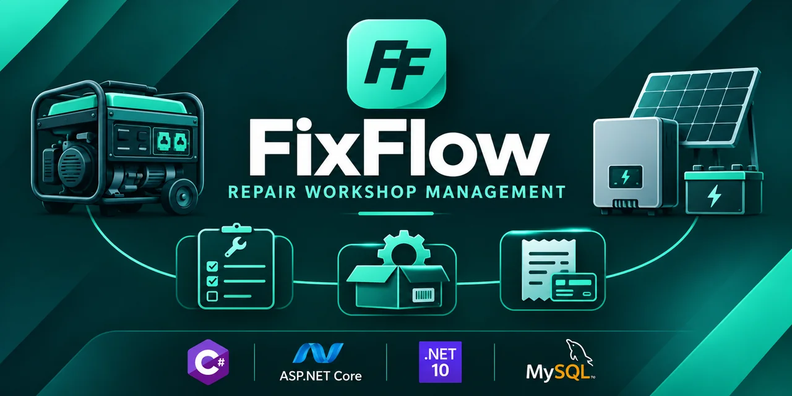
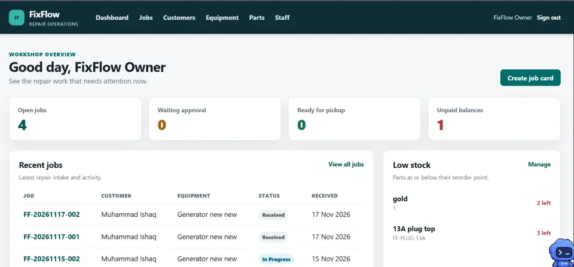
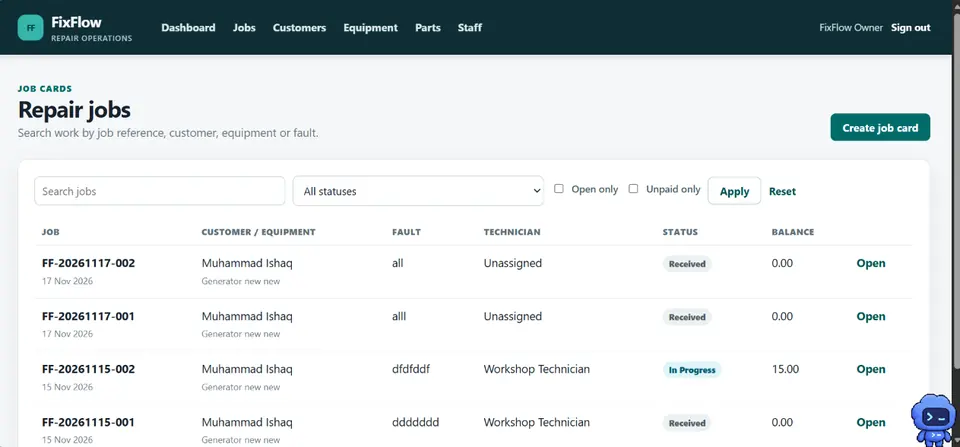
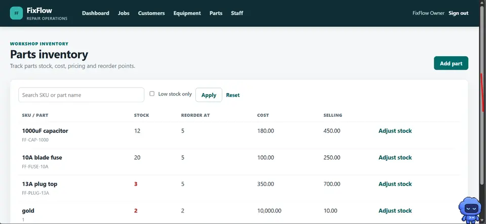
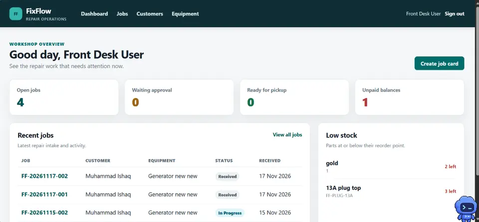
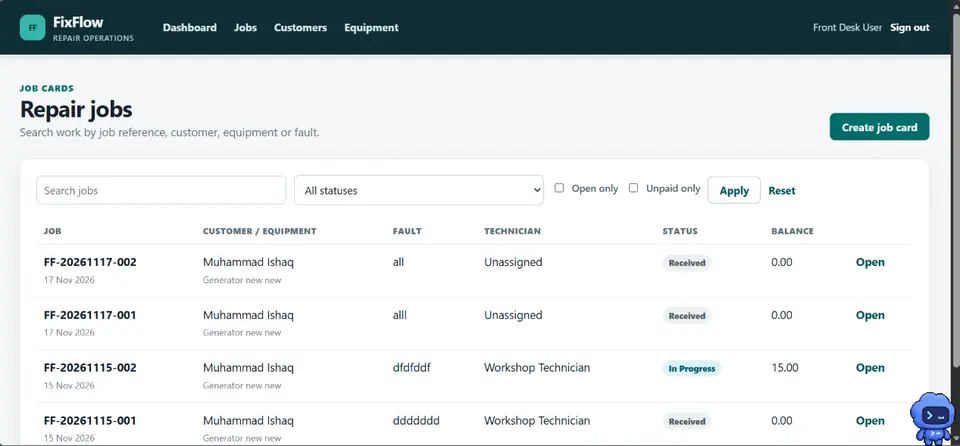
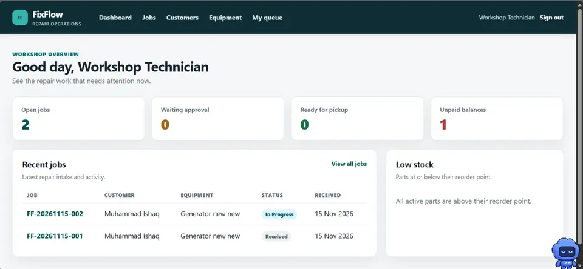
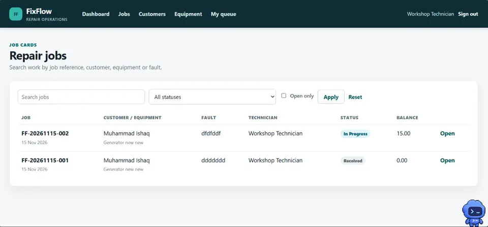

<div align="center">
  
  <h1>FixFlow</h1>
  <p><strong>Repair workshop operations, from customer intake to collection.</strong></p>
  <p>
    
    
    
    
  </p>
</div>

## Overview

FixFlow is a workshop management application for businesses that repair generators, solar systems, inverters and electronics. It brings customer and equipment records, repair job cards, diagnosis, estimates, approvals, technician work, spare-parts inventory, payments and printable records into one workflow.

The application is built with **C#, ASP.NET Core Razor Pages, .NET 10, Entity Framework Core and MySQL**. It uses server-side authentication and authorization, role-specific navigation, and workflow rules enforced by the application rather than relying only on the UI.

## Application screenshots

The following screenshots were captured from the running FixFlow application. They show the three staff roles using the same workshop data in a local development environment.

### Owner / Admin

Owner/Admin users have access to the workshop overview, repair jobs, parts inventory, stock adjustments and staff administration.

| Workshop dashboard | Repair jobs |
|---|---|
|  |  |

**Parts inventory**



### Front Desk

Front Desk users handle customer and equipment intake, create job cards, prepare estimates, record estimate decisions and record payments.

| Front Desk dashboard | Front Desk repair jobs |
|---|---|
|  |  |

### Technician

Technicians see their assigned work, open permitted job details, add notes, follow valid job-status transitions and record parts used while a job is in progress.

| Technician dashboard | Technician queue / repair jobs |
|---|---|
|  |  |

## Main functionality

- **Customers and equipment:** customer contact records and linked generator, inverter, solar-system and electronics records.
- **Repair job cards:** human-readable references (`FF-yyyyMMdd-###`), fault description, intake condition/accessories, expected completion date and job history.
- **Repair workflow:** Received → Diagnosing → Awaiting Approval → In Progress → Ready for Pickup → Collected, with cancellation from active states.
- **Estimates and approval:** parts and labour estimates, recorded approval/rejection decisions, and an approved-estimate requirement before work starts.
- **Role-based access:** Owner/Admin, Front Desk and Technician roles. Technicians can access only jobs assigned to them.
- **Staff administration:** Owner/Admin can create staff accounts, reset passwords, deactivate accounts and reactivate accounts.
- **Inventory:** parts catalogue, stock levels, reorder points, manual adjustments, stock-movement history and job-parts usage with a no-negative-stock rule.
- **Payments:** partial and full payments, outstanding-balance checks, receipt numbers and print-friendly receipts.
- **Workshop overview:** dashboard counts, recent jobs, pending approvals, pickup jobs, outstanding balances and low-stock parts.

## Technology

- C# and ASP.NET Core Razor Pages on **.NET 10** (`net10.0`)
- HTML, CSS and JavaScript (no front-end framework)
- Entity Framework Core 10
- MySQL using Oracle Connector/NET `MySql.EntityFrameworkCore`
- Cookie authentication with server-side role and job-access checks
- xUnit automated tests in the separate `FixFlow.Tests` project

## Local setup

1. In MySQL, run [Database/01_create_schema.sql](Database/01_create_schema.sql), then optionally [Database/02_seed_data.sql](Database/02_seed_data.sql). The schema script creates `FixFlowDb` if it does not already exist.
2. Store the real local MySQL connection string in User Secrets. From the `FixFlow` project folder, run:

   ```powershell
   dotnet user-secrets init
   dotnet user-secrets set "ConnectionStrings:FixFlowDb" "Server=localhost;Port=3306;Database=FixFlowDb;User Id=YOUR_LOCAL_MYSQL_USER;Password=YOUR_LOCAL_MYSQL_PASSWORD;"
   ```

   Do not commit a real connection string. Keep local credentials out of `appsettings.json` and source control.

3. Restore and run:

   ```powershell
   dotnet restore
   dotnet watch
   ```

4. Open the local URL shown in the terminal.

## Development seed accounts

The development seed script creates these accounts if they do not already exist:

| Username | Role | Development password |
|---|---|---|
| `owner` | Owner/Admin | `ChangeMe123!` |
| `frontdesk` | Front Desk | `ChangeMe123!` |
| `technician` | Technician | `ChangeMe123!` |

These are development-only credentials. Change or remove them before using real workshop data or exposing the application to a network. Do not use default passwords in production.

## Automated tests

From the `FixFlow` project folder, run:

```powershell
dotnet test ..\FixFlow.Tests\FixFlow.Tests.csproj
```

The current automated suite covers job-total calculations, password hashing/verification and allowed job-status transitions. Database locking and concurrency behavior still require integration testing against the configured MySQL database.

## Security and production notes

- Use unique staff passwords of at least 12 characters.
- Change or remove development seed accounts before production use.
- Store production connection strings in a secret store, not in source control.
- Back up MySQL before applying schema changes.
- Technicians are restricted to jobs assigned to them; authorization is checked server-side.
- Payment row locking, receipt-number locking and job-reference locking rely on MySQL behavior and should be tested under the intended deployment configuration.

## Project status

FixFlow is a portfolio and development project. It has a working local application, a separate automated test project, and a documented MySQL setup. A production deployment should include live-MySQL integration tests, deployment configuration, backup/restore procedures and operational monitoring.
