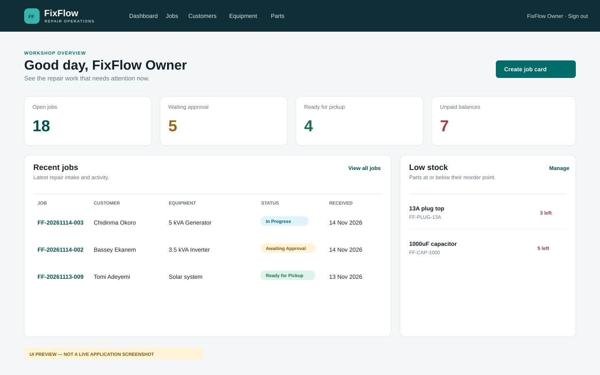

# FixFlow

FixFlow is an operational repair-workshop application for generator, solar/inverter and electronics repairs. It keeps customer equipment, job cards, diagnosis, estimates, approvals, technician work, spare parts, payments and printable records together.



> The image above is a design preview, not a screenshot from a running application.

## Technology

- ASP.NET Core Razor Pages on **.NET 10** (`net10.0`)
- C#, plain HTML, CSS and JavaScript — no UI framework
- MySQL using Oracle Connector/NET `MySql.EntityFrameworkCore` **10.0.12** with EF Core **10.0.12** design tooling
- Local cookie authentication with server-side role and record access checks

## Included functionality

- Customer contacts and linked equipment records: generator, inverter, solar system and electronics
- Human-readable repair references (`FF-yyyyMMdd-###`), intake condition/accessories, due date and job history
- Server-enforced workflow: Received → Diagnosing → Awaiting Approval → In Progress → Ready for Pickup → Collected, with cancellation from active states
- Diagnosis notes, estimates, recorded customer approval/rejection, and an approved estimate requirement before work starts
- Owner/Admin, Front Desk and Technician roles. A technician can access only jobs assigned to that technician. Owner/Admin can create staff accounts, deactivate/reactivate accounts and reset passwords.
- Technician assignment and a personal work queue
- Stock catalogue, low-stock dashboard list, stock adjustments, transactional job-parts usage, and a no-negative-stock rule
- Partial/full manual payments, outstanding balance checks, print-friendly job card and receipt
- Search, filtering, histories and dashboard counts for open work, approvals, pickup jobs, balances and stock

## Local setup

1. In MySQL, run [Database/01_create_schema.sql](Database/01_create_schema.sql), then optionally [Database/02_seed_data.sql](Database/02_seed_data.sql). The schema script creates only `FixFlowDb` if it does not already exist. It does not drop or alter existing databases or tables.
2. Store the real local MySQL connection only in User Secrets. From this folder, run:

   ```powershell
   dotnet user-secrets init
   dotnet user-secrets set "ConnectionStrings:FixFlowDb" "Server=localhost;Port=3306;Database=FixFlowDb;User Id=YOUR_LOCAL_MYSQL_USER;Password=YOUR_LOCAL_MYSQL_PASSWORD;"
   ```

   Do not commit that connection string. `appsettings.json` contains only a non-working placeholder under the exact key `ConnectionStrings:FixFlowDb`.

3. Restore and run:

   ```powershell
   dotnet restore
   dotnet run
   ```

4. Open the local URL shown by ASP.NET Core.

## Development seed accounts

`02_seed_data.sql` creates development-only accounts if they do not already exist:

| Username | Role | Development password |
| --- | --- | --- |
| `owner` | Owner/Admin | `ChangeMe123!` |
| `frontdesk` | Front Desk | `ChangeMe123!` |
| `technician` | Technician | `ChangeMe123!` |

The app also seeds those accounts only when running in Development, only if the database has no users. Change or remove them before recording real workshop data or exposing the application to a network. Do not use a default owner account in production.

## Role guide

| Role | Can do |
| --- | --- |
| Owner/Admin | All operations, technician assignments, parts catalogue, stock adjustments and staff account administration |
| Front Desk | Customer/equipment intake, job cards, estimates/approval and manual payments |
| Technician | Assigned jobs only; notes, valid workflow moves, and parts usage while work is in progress |

Permissions are checked on the server. Hiding a link is not treated as authorization. Disabled accounts are rejected on subsequent requests, and the final active Owner/Admin account cannot be deactivated.

## Workflow rules

Valid moves are enforced server-side. Closed jobs cannot be reopened through the interface. An estimate must be approved before a job can move from **Awaiting Approval** to **In Progress**. Parts usage is allowed only while the job is **In Progress** and is saved with the inventory reduction in one database transaction.

## Automated tests

A separate `FixFlow.Tests` project covers the job-total calculation, password hashing/verification and allowed job-status transitions. From the `FixFlow` project folder, run:

```powershell
dotnet test ..\FixFlow.Tests\FixFlow.Tests.csproj
```

The tests do not replace live-MySQL integration checks. Payment row locks, receipt-number locks and job-reference locks must be exercised against the configured MySQL database because EF Core's in-memory provider cannot reproduce MySQL locking behavior.

## Production notes

- Use unique staff passwords of at least 12 characters.
- Change or remove the development seed accounts before production use.
- Store the production connection string in a secret store, not in source control.
- Back up the MySQL database before applying schema changes.
- The current `Database/01_create_schema.sql` includes the stock-movement staff and repair-job foreign keys. Existing databases should be inspected before running any manual `ALTER TABLE` statements. Job creation now writes its job card and initial status-history row in one EF Core save transaction. Payment balances are recalculated from fresh database aggregates after the repair-job row is locked.
